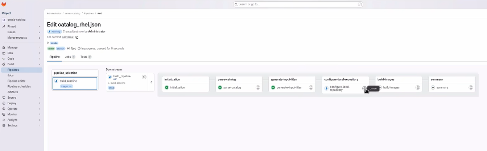
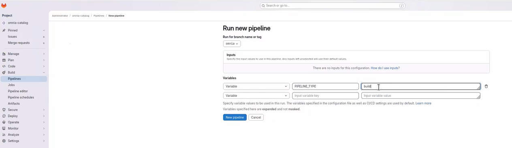
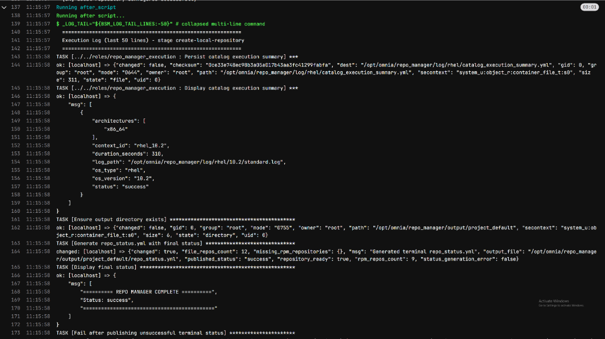

# Execute Build Pipeline

Update the `catalog_rhel.json` file and execute the BuildStreaM build pipeline through GitLab. This procedure covers catalog modifications, pipeline triggering (automatic and manual), and verification of pipeline status.

## Overview

The BuildStreaM build pipeline independently creates diskless images without
deploying them. The pipeline consists of five sequential stages:

- **initialization**: Checks the BSM API, authenticates, and creates the pipeline job.
- **parse-catalog**: Uploads and validates the catalog, including its image-group identifier.
- **configure-local-repository**: Runs the Repository Manager workflow for the selected catalog.
- **build-images**: Runs the Image Build Manager workflow for the selected architectures.
- **summary**: Retrieves and displays the final BuildStreaM job status.

The build pipeline is automatically triggered when you update the
`catalog_rhel.json` file in the GitLab repository, or it can be manually
initiated through the GitLab interface. BuildStreaM identifies a catalog
revision as `<catalog.identifier>-v<catalog.version>`.

In catalog mode, Image Build Manager checks the project-level global image
dictionary before rebuilding each functional group. With
`build_image.force_rebuild: false`, a dictionary entry is reused only when its
package hash matches and its recorded kernel, initramfs, and root filesystem
objects still exist. Set `force_rebuild: true` to bypass this lookup.

The separate cadence pipeline uses a different root catalog and continues from
build through deployment and validation. See
[Automate Build and Deployment with Cadence](execute_cadence_pipeline.md).

!!! warning

    Do not cancel a running GitLab pipeline or stage. Cancellation prevents some pipeline steps from executing, which leaves the BuildStreaM job in an intermediate, inconsistent state.

!!! note

    The current GitLab configuration does not serialize pipelines. Concurrent
    pipelines can access shared resources, so avoid overlapping operations that
    update the same catalog, mapping, image, or deployment state.

!!! note

    Wait for another pipeline that uses the same catalog or image resources to
    finish before starting this build.

## Prerequisites

- BuildStreaM container is deployed on the OIM node
- GitLab deployment for BuildStreaM is completed (see [BuildStreaM](index.md))
- You can access the GitLab project repository
- **200 GB free disk space** on the OIM **/ partition** before triggering the build pipeline
  - This requirement applies to the OIM root partition before pipeline execution
  - Insufficient disk space can cause pipeline failures during image builds
  - Monitor disk usage during pipeline execution, especially for multi-architecture builds

### Repository content prerequisites

Select the RHEL 10.0 or RHEL 10.2 catalog that matches the workload, node
architectures, and VAST requirement from the directory below. RHEL 10.2 is
validated on x86_64 only; use RHEL 10.0 for aarch64. See the
[Operating Systems Matrix](../../Reference/SupportMatrix/operating_systems.md).

```text
src/main/samples/catalogs/rhel/<RHEL-version>/
```

See [Select or update the catalog](../main/update_catalog.md) for the available
Slurm, service Kubernetes, combined, and `_no_vast` variants. Before starting
the pipeline, configure each repository referenced by the selected catalog in
`input/repo_manager/repo_manager_config.yml`.
Configure the Pulp service endpoint in
`input/repo_manager/repo_manager_endpoint_config.yml`.

| Repository content | Prerequisite |
|---|---|
| RHEL | Use an active RHEL subscription or provide reachable `baseos`, `appstream`, and `codeready-builder` URLs for every selected architecture. |
| Slurm | [Build and host](../../Operations/repo_manager/build_slurm_repo.md) the catalog-required Slurm RPMs and configure `repositories."<RHEL-version>".<architecture>.user_repos.slurm_custom.url`. Package names in the repository must match the selected catalog. |
| LDMS | [Build and host](../../Operations/repo_manager/build_ldms_repo.md) the catalog-required `ovis-ldms` RPM and configure `repositories."<RHEL-version>".<architecture>.user_repos.ldms.url`. The supplied RHEL 10.0 and RHEL 10.2 catalogs reference this repository. |
| VAST | When the selected catalog references `vast`—the Slurm variants without the `_no_vast.json` suffix—host the `vastnfs` RPM and configure `repositories."<RHEL-version>".<architecture>.user_repos.vast.url`. A VAST repository is not required by the `_no_vast` variants. |

Each custom repository must expose `repodata/repomd.xml` and be reachable from
the OIM. Repository Manager synchronizes and publishes these repositories; it does
not build the Slurm, LDMS, or VAST RPMs. For configuration details, see
[Add an RPM Repository and Packages](../repo_manager/adding_additional_repositories.md) and
[Software Requirements](../../Reference/ClusterRequirements/software_requirements.md).

## Procedure

### Trigger Build Pipeline Automatically

1. Go to the GitLab project URL:

    ```text title="GitLab project URL"
    https://<gitlab_host>:<gitlab_https_port>/root/<gitlab_project_name>
    ```

2. Navigate to **Code** → **Repository**.

3. Locate the catalog file `catalog_rhel.json`.

4. Modify the `catalog_rhel.json` file to define your build requirements.

    !!! note

        Ensure that the catalog file is updated with valid values. The pipeline fails if invalid details are provided.

        Supported values:

        - **Functional group names**: `slurm_control_node_rhel_10_<minor>_x86_64`, `slurm_node_rhel_10_<minor>_x86_64`, `service_kube_control_plane_rhel_10_<minor>_x86_64`, `service_kube_node_rhel_10_<minor>_x86_64`, `login_node_rhel_10_<minor>_x86_64`, `login_compiler_node_rhel_10_<minor>_x86_64`, and `os_rhel_10_<minor>_x86_64`, where `<minor>` is `0` or `2`; and `slurm_node_rhel_10_0_aarch64`, `login_node_rhel_10_0_aarch64`, `login_compiler_node_rhel_10_0_aarch64`, and `os_rhel_10_0_aarch64`. RHEL 10.2 is validated on x86_64 only, so aarch64 group names use `10_0`. Use the same `<minor>` for all Kubernetes groups.
        - **Architecture type**: `x86_64` and `aarch64`
        - **OS type**: `RHEL`
        - **OS version**: `10.0` or `10.2` for `x86_64`; `10.0` for `aarch64`
        - **Package types**: `rpm`, `rpm_repo`, `image`, `iso`, `tarball`, `pip_module`, `git`, `manifest`

        For another revision of the same catalog family, retain
        `catalog.identifier` and increment `catalog.version`. New Omnia 2.3
        catalogs use `catalog.schema_version: 2`.

5. Commit the catalog changes. The pipeline triggers automatically.

    

6. Monitor the pipeline progress.

    

### Trigger Build Pipeline Manually

1. Navigate to **Build** → **Pipelines**.

2. Click **New Pipeline**.

3. In the **Run new pipeline** dialog box, enter the variable name as **PIPELINE_TYPE** and enter the value as **build**.

    

4. Click **Run Pipeline** to execute the build pipeline.

### Monitor Build Pipeline Progress

1. Navigate to **Build** → **Pipelines**.

2. Click on the running pipeline to view details.

3. Monitor each stage as it progresses:

    - **initialization**: Checks the BSM API, authenticates, and creates the job
    - **parse-catalog**: Uploads and validates the catalog
    - **configure-local-repository**: Configures repositories for the selected catalog
    - **build-images**: Builds images for the selected architectures
    - **summary**: Displays the final job status

4. Review the stage status indicators:

    - **Green checkmark**: Stage completed successfully
    - **Red X**: Stage failed (click for error details)
    - **Blue circle**: Stage currently running

5. If any stage fails, review the error logs by clicking on the failed job.

6. For the **configure-local-repository** and **build-images** stages, open the
   job and review the execution-log preview in the GitLab job console. For the
   complete stage log, see [View Stage Execution Logs](#view-stage-execution-logs).

### View Stage Execution Logs

BuildStreaM records an execution log for each pipeline stage that runs an
Ansible playbook. In the build pipeline, these stages are
**configure-local-repository** and **build-images**. Stages that do not run a
playbook, such as **parse-catalog**, have no execution log. BuildStreaM redacts
secrets when it writes a log and again when it serves the log.

You can review a stage log in either of the following ways:

- **GitLab job console:** When a playbook stage finishes or fails, the job
  console previews the last lines of that stage's execution log.
- **BSM API:** Request the log of a stage, or of the complete job, for a
  specific BuildStreaM job.

#### Review the Log Preview in the GitLab Job Console

At the end of the job output, in the `Running after_script` section, the
console prints a block that starts with
`Execution Log (last <n> lines) - stage <stage>`. The `log_ci_preview_lines`
parameter sets the number of lines; the default is `50`.

The following image shows the preview of a successful
**configure-local-repository** job. The values in your output differ.



In the output, the stage name is the BuildStreaM API stage name. For the
**configure-local-repository** job it is `create-local-repository`, and for the
**build-images** job it is `build-image`.

#### Query the Stage Log through the BSM API

1. Obtain the job identifier. The pipeline description shows it as
   `BSM Job: <job_id>`, and the **initialization** job log reports it as
   `Job ID`.

2. Obtain an access token for the registered BSM API client. The client ID and
   client secret are the GitLab project CI/CD variables `BSM_CLIENT_ID` and
   `BSM_CLIENT_SECRET`.

    ```bash title="Run on: OIM host"
    curl --cacert /opt/omnia/build_stream_ssl/ssl/bs_cert.pem \
      -X POST "https://<build_stream_host_ip>:<build_stream_port>/api/v1/auth/token" \
      -H "Content-Type: application/x-www-form-urlencoded" \
      -d "grant_type=client_credentials&client_id=<CLIENT_ID>&client_secret=<CLIENT_SECRET>"
    ```

3. Request the log of one stage:

    ```bash title="Run on: OIM host"
    curl --cacert /opt/omnia/build_stream_ssl/ssl/bs_cert.pem \
      -H "Authorization: Bearer <TOKEN>" \
      "https://<build_stream_host_ip>:<build_stream_port>/api/v1/jobs/<job_id>/logs?stage=create-local-repository&tail_lines=100"
    ```

    To request the full job log instead, use `?full=true`. If
    `OMNIA_DATA_PATH` is not `/opt/omnia`, adjust the certificate path.

When a playbook stage fails, the job console also prints these commands under
`Retrieve complete execution logs through the BSM API`, with the host, port, and
job identifier of the failed job already filled in.

The request accepts the following query parameters:

| Parameter | Description |
|---|---|
| `stage` | Returns the execution log of one stage. Use the BuildStreaM API stage name: `create-local-repository`, `build-image`, `deploy`, or `restart`. |
| `tail_lines` | Number of lines to return from the end of the log. If you omit it, BuildStreaM returns `log_tail_lines_default` lines (default `50`). The value must be from `1` through `log_tail_lines_max` (default `10000`). If the value is above `log_tail_lines_max`, the API returns an error. |
| `full` | Set to `true` to request the full job log. |

The following limits apply to log queries. You can change each limit in
`build_stream_config.yml`. See
[Pipeline log observability settings](../../Reference/Configuration/build_stream_config.md#pipeline-log-observability-settings).

| Limit | Default | Behavior when exceeded |
|---|---|---|
| Lines requested with `tail_lines` (`log_tail_lines_max`) | 10,000 | The API returns an error. |
| Response size (`max_log_response_bytes`) | 10 MiB | BuildStreaM drops the oldest content first and flags the response as `truncated`. |
| Requests for each client each minute (`log_query_rate_limit`) | 60 | The API returns HTTP `429`. |
| Simultaneous requests across all clients (`log_query_max_concurrent`) | 5 | The API returns HTTP `503` with a `Retry-After` header. |

### Update Input Configuration Files

To update the input configuration files before a manual build:

1. Navigate to the `input/` folder in the GitLab repository.

2. Edit the relevant configuration file.

3. Commit and push the changes.

## Verification

After the pipeline completes:

1. Navigate to **Build** → **Pipelines**.

2. Review the job list and status.

3. Click on individual jobs to view execution logs, resource usage, and error messages.

4. For a catalog-mode build, verify the catalog-specific result:

    ```text
    $OMNIA_DATA_PATH/image_build_manager/output/$OMNIA_PROJECT_NAME/<identifier>-v<version>/build_status.yml
    ```

5. Review the global image dictionary when the log reports a dictionary hit:

    ```text
    $OMNIA_DATA_PATH/image_build_manager/output/$OMNIA_PROJECT_NAME/image_group_dictionary.json
    ```

## Next steps

- [Execute Deploy Pipeline](execute_deploy_pipeline.md) -- Deploy the built images to cluster nodes
- [Automate Build and Deployment with Cadence](execute_cadence_pipeline.md) -- Reconcile RPM content and run build and deployment together
- [Cleanup Operations](cleanup_operations.md) -- Remove old Image Groups manually or configure automated cleanup based on age-based retention policies

## Troubleshooting

- **Parse-Catalog stage failing**: Ensure the JSON is aligned with the expected schema. See catalog examples at [https://github.com/dell/omnia/tree/issue-4849-omnia-modernization/src/main/samples/catalogs](https://github.com/dell/omnia/tree/issue-4849-omnia-modernization/src/main/samples/catalogs).
- **Repository Manager stage failing**: Check the log path from the API
  response and verify the selected catalog, `repo_manager_config.yml`, and
  `repo_manager_endpoint_config.yml`.
- **Build-Image stage failing**: Ensure the catalog has valid functional groups.
- **A dictionary entry is not reused:** Confirm that `force_rebuild` is
  `false` and that all three S3 artifacts recorded by the entry still exist.
  Missing artifacts convert the lookup to a rebuild.
- For additional issues, see [BuildStreaM Troubleshooting](../../Troubleshooting/build_stream/build_stream.md).


